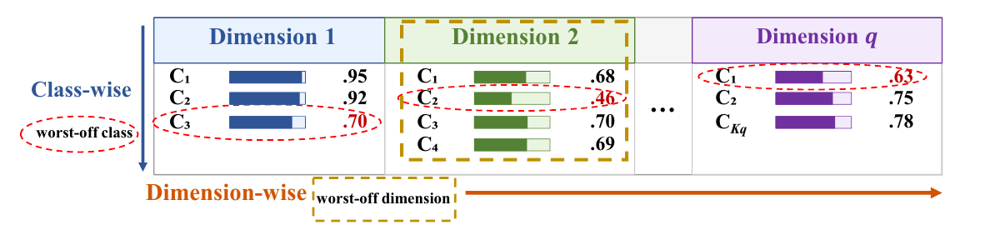

# FARM

Code for **Fair Multi-Dimensional Classification**, accepted for publication at the 33rd ACM SIGKDD Conference on Knowledge Discovery and Data Mining (KDD 2027).

Multi-dimensional classification predicts one class in each of several output dimensions. Fair multi-dimensional classification considers both the worst-performing class within each dimension and the worst-performing dimension overall.



## Run the examples

Use Python 3.9 or later and a CUDA-enabled PyTorch installation. From this directory, install the dependencies and run:

```bash
python -m pip install -r requirements.txt
python main.py --dataset Edm
python main.py --dataset BeLaE
```

Each command runs all ten predefined folds on CUDA and reports metrics for the final epoch. To run one fold at the full training settings, pass `--fold 0`. For CPU execution, pass `--device cpu`.

| Setting | Default |
| --- | --- |
| Device | CUDA |
| Folds | All ten predefined folds, indexed 0 through 9 |
| Training epochs | 500 |
| Prototype regularization warm-up | 100 epochs |
| Batch size | 512 |
| Hidden and embedding sizes | 512 each |
| Activation and dropout | ReLU, dropout disabled |
| Optimizer | SGD with momentum 0.9 and weight decay 0.0001 |
| Learning rate | 0.1 during warm-up, then cosine decay to zero |
| Prototype EMA momentum | 0.9 |
| Prototype loss weight | 0.1 |
| LogSumExp temperature | 5.0 |
| Random seed | 0 |

Training defaults and dataset-specific class exclusions are defined in `config.py`. The bundled examples are `datasets/Edm.mat` and `datasets/BeLaE.mat`. The other benchmarks can be run by placing the corresponding MATLAB files in `datasets/`, or by passing `--data-dir`. The datasets and predefined splits are available from the [PALM benchmark collection](https://palm.seu.edu.cn/zhangml/Resources.htm#MDC_data) for academic use.

## Evaluate saved predictions

`main.py` saves predictions and calls `evaluation.py` automatically. To recompute metrics without retraining, run:

```bash
python evaluation.py --dataset Edm
python evaluation.py --dataset BeLaE
```

Use the same `--fold`, `--data-dir`, and `--output-dir` options as the training command when applicable. By default, each dataset has its own directory at `results/<dataset>/`. The `fold<N>_predictions.csv` files contain zero-based class IDs in test-fold order. The evaluator writes per-fold Hamming Score, Exact Match, Sub-Exact Match, WD-BAcc, MinWCRec, and per-dimension WC-Rec to `metrics.csv` (or `fold<N>_metrics.csv` for one fold). It also prints the mean and standard deviation across the evaluated folds.

The class exclusions in `config.py` apply only to WC-Rec and MinWCRec. For Edm, the excluded class is `increase` in `flow_control` (dimension 1, class 2, zero-based). BeLaE has no class exclusions.
